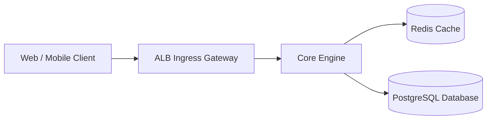

# <Project Name>

<One-line value proposition and primary service responsibility.>

---

## 1. Quickstart (The 30-Minute Onboarding Invariant)
A new engineer or autonomous agent must be able to boot this project locally and pass the test suite in under 30 minutes:

```bash
# 1. Clone & enter repository
git clone <repo-url> && cd <project-name>

# 2. Boot dependencies locally
docker compose up -d

# 3. Install dependencies & run verification
make setup
make test
```

---

## 2. Architecture & Service Topology
System design and data flow represented as code:



---

## 3. Operational Links & Living Documentation
- **Architecture & ADRs:** Permanent architectural records stored under [`architecture/decisions/`](architecture/decisions/).
- **Operational Runbooks:** Incident SOPs stored under [`runbooks/`](runbooks/).
- **Work Unit Deltas:** Active change specifications stored under [`openspec/changes/`](openspec/changes/).
- **Agent Operating Rules:** Autonomous agent boundaries defined in [`AGENTS.md`](AGENTS.md).

---

## 4. Verification & Smoke Testing
Deterministic commands to validate code and contracts:

```bash
# Fast domain invariants (< 10 seconds):
make test-invariants

# End-to-end runtime smoke proof:
make test-smoke

# In-repo documentation and frontmatter linters:
make lint-docs
```
