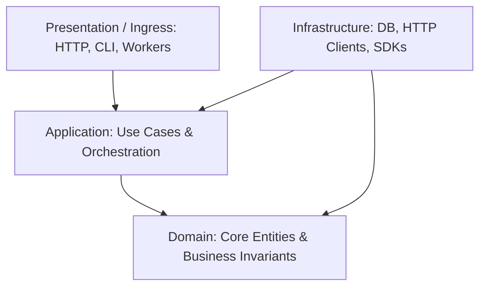

# Clean Architecture & Core Domain Boundaries

## 1. The Core Rule: Inward Dependencies Only
Dependencies must strictly point inward. Inner layers never import from outer layers.

## 2. The Three Inviolable Invariants
1. **Pure Domain (`src/domain/`):**
   - Holds business entities and validation rules.
   - **Zero** external framework, database, or network imports.
2. **Isolated Application (`src/application/`):**
   - Coordinates use cases and business operations.
   - Declares output ports (interfaces) for data persistence or external services.
3. **Swappable Infrastructure (`src/infrastructure/`):**
   - Implements the ports declared by Domain/Application (SQL, external APIs, cloud SDKs).
   - Storage schemas and API models must never leak into the domain.

## 3. Progressive DDD Guidelines
Start simple. Introduce deeper DDD tactical patterns only when business complexity demands it:
- **Day 1 (Entities & Functions):** Simple domain models validating self on instantiation, with pure functions enforcing domain invariants.
- **When State Conflicts Arise (Aggregates):** Define explicit aggregate roots to guard multi-entity transaction boundaries.
- **When Complex Primitives Repeat (Value Objects):** Wrap scalar types in immutable objects with validation (e.g., `Email`, `Money`).
- **When Asynchronous Side-Effects Multiply (Domain Events):** Emit domain events for decoupled cross-boundary reactions.

## 4. Verification
- Validate structural and import boundaries with `just test-invariants`.
- Validate documentation frontmatter with `just lint-frontmatter`.
