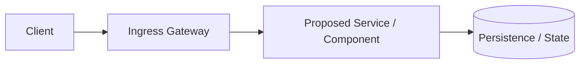

# RFC-YYYYMMDD-<slug>: Title

## 1. Context & Problem
- **Problem:** What is the technical limitation or pain point today?
- **Proposed Outcome:** What will the system look like or achieve after this change?
- **Non-Goals:** What are we deliberately choosing not to solve here?

## 2. Proposed Architecture
- **High-Level Design:** Explanation of the approach (patterns, system components, or high-level flow).

- **Key Technical Decisions:** Major architectural choices (e.g., choice of library, protocol, or data boundary).

## 3. Trade-offs & Alternatives
- **Why this approach:** Primary technical rationale.
- **Alternatives considered:** Other options evaluated and why they were rejected.
